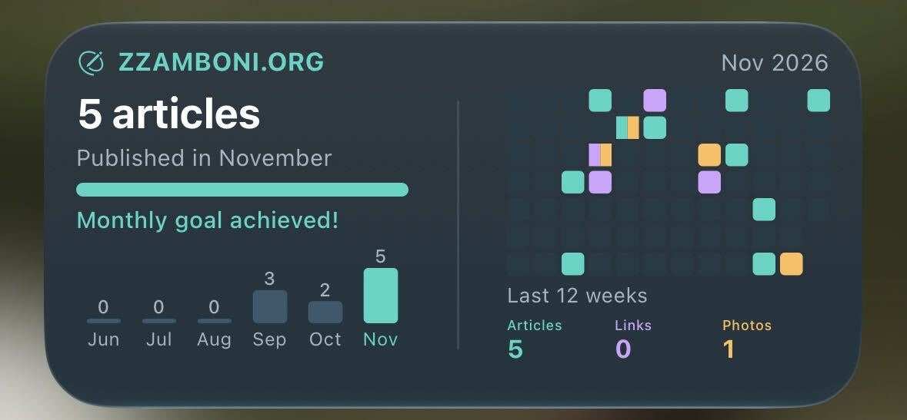
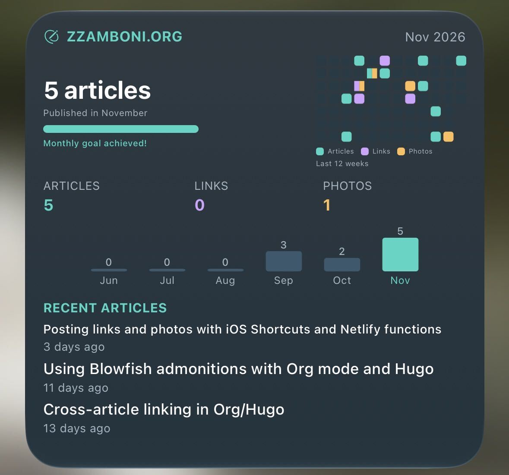
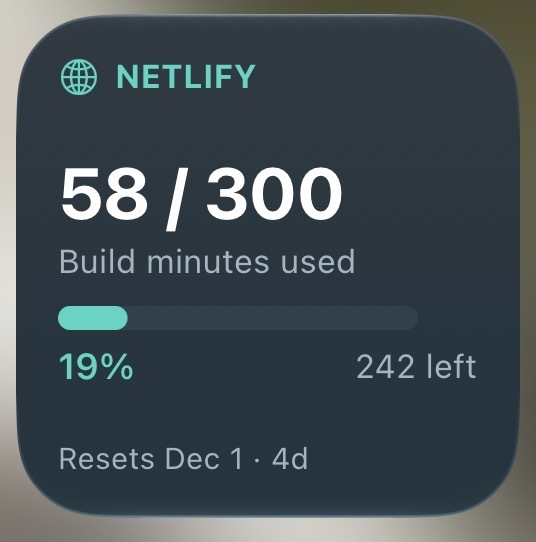
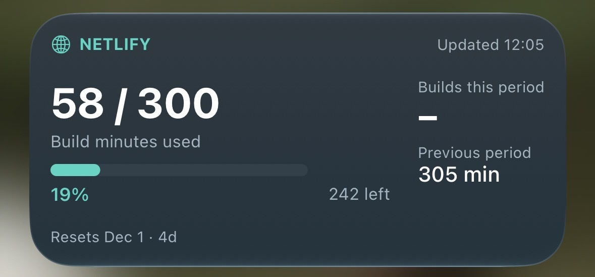

#+TITLE: Scriptable Widgets

A collection of iOS widgets for [[https://scriptable.app/][Scriptable]], with a small synchronization script for managing them from a Git repository. The widgets share a dark teal visual style and keep their last successful data locally for offline use.

* Blog Publishing Tracker

Track publishing activity on a Hugo blog using public RSS feeds, without credentials or additional server-side infrastructure.

| Small                                 | Medium                                 | Large                                 |
|  |  |  |

- Small: monthly article goal, six-month publishing chart and latest article age.
- Medium: monthly counts by post type and a twelve-week activity heatmap.
- Large: adds publishing history and three individually clickable recent articles.

*Configuration:* Edit =SETTINGS= in [[file:widgets/Blog Publishing Tracker.js][Blog Publishing Tracker.js]] to configure the site URL, display name, monthly goal, time zone, history and heatmap length, and photo/link tags. The supplied defaults target zzamboni.org, using =photos= and =linky=. A goal of zero disables the goal display.

The script requires =/post/index.xml= and both configured =/tags/<tag>/index.xml= feeds. If fetching fails, it uses cached data when available. Historical counts are only as complete as the RSS feeds; a zero may indicate missing history. The cache is shared by instances of this script.

* Netlify Build Minutes

| Small                              | Medium                              |
|  |  |

Monitor build minutes used, allowance remaining, billing-period reset and usage thresholds. The medium widget also shows build count, previous-period usage and active/queued builds when available.

*Configuration:* Edit [[file:widgets/Netlify usage.js][Netlify usage.js]] and change the =account= constant inside =setup()= to your Netlify team slug (the supplied value is =zzamboni=). Create a Netlify personal access token, copy it to the clipboard, and run the script in Scriptable. The token is imported into the iOS Keychain and the clipboard is cleared. Never commit your token. Run the script again to preview or change credentials.

This widget uses the Netlify =/api/v1/<account>/builds/status= endpoint and requires a plan that exposes build-minute allowance data.

* Installation

1. Install Scriptable on your iPhone.
2. Create a script with the same name as the desired JavaScript file (without the =.js= extension), paste its contents, and run it once. Alternatively, copy the JavaScript file into the Scriptable scripts folder.
3. Add a Scriptable home-screen widget in a supported size and select the script.

* Synchronizing from GitHub

Install [[file:Sync%20Widgets.js][Sync Widgets.js]] once using the same procedure. Set =useICloud= to match where Scriptable stores your scripts. The default is iCloud. Run the sync script inside Scriptable to download the two widget files from the public repository's main branch. Existing files are overwritten only when different, with the previous version saved under =Widget Backups= as a =.bak= file. The sync script does not update itself or delete files. Existing widget assignments should remain intact if filenames match.

On your laptop, clone the repository, edit the scripts in your preferred editor, commit and push, then run Sync Widgets on your phone. Local edits on the phone will be overwritten by the repository version; make configuration changes in your own trusted repository or branch. The Netlify Keychain entries are not changed by synchronization.

Only synchronize from a repository and branch you trust: downloaded JavaScript will run with Scriptable's permissions, including access to stored credentials. Review changes before syncing. The synchronization script is experimental and needs on-device testing. Refresh intervals are requests to iOS, not guaranteed schedules.
